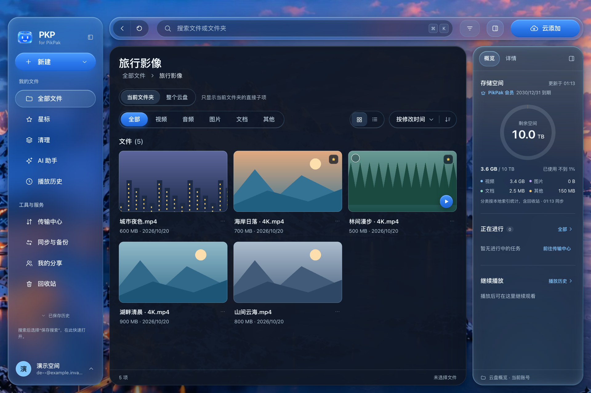
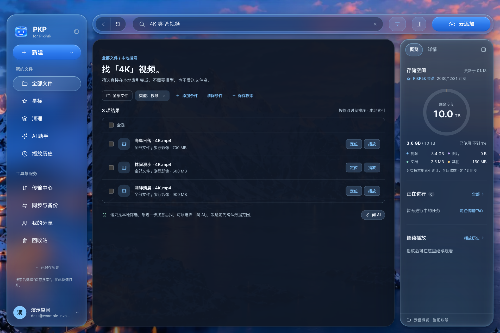
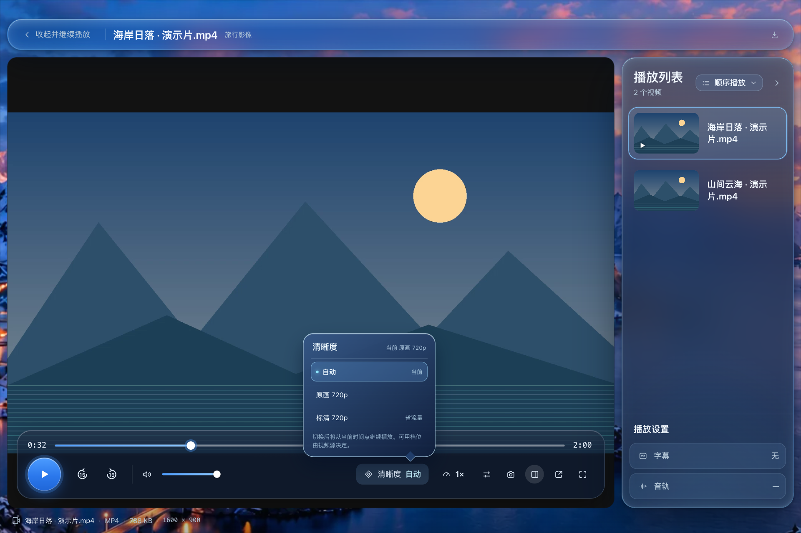
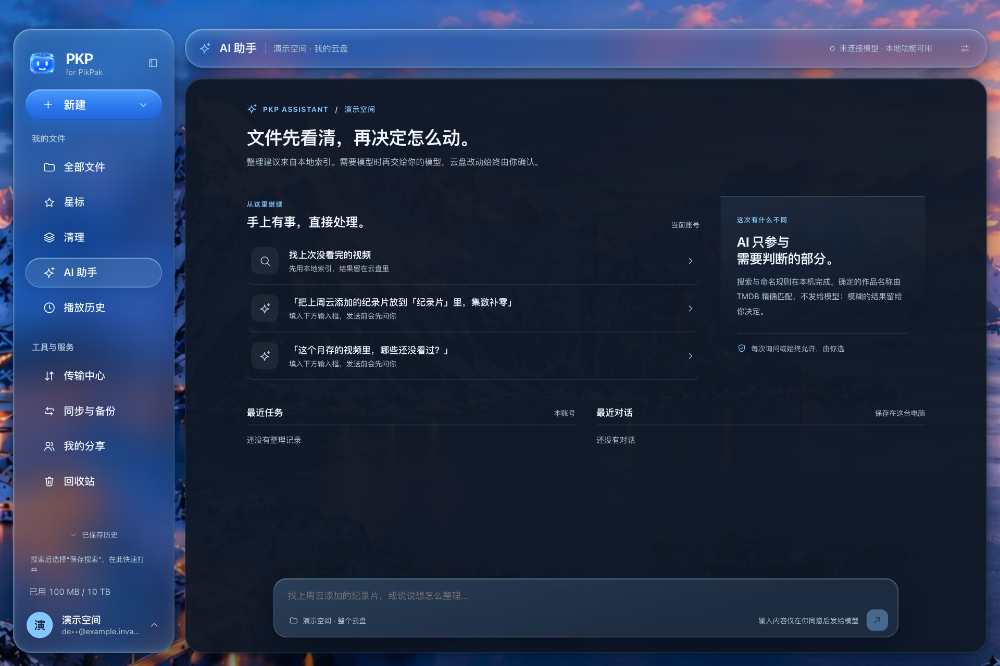
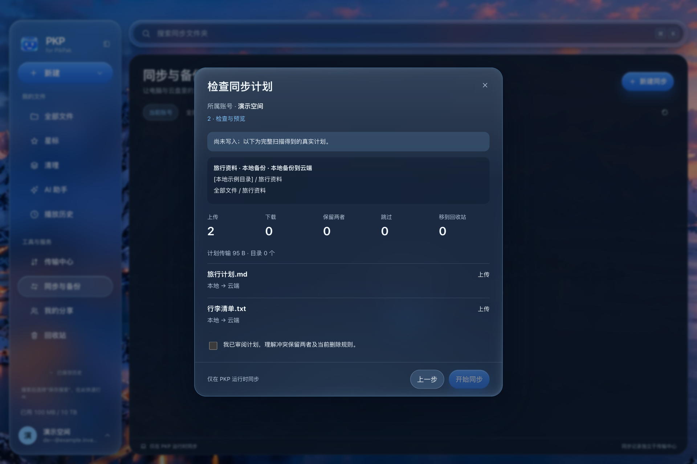
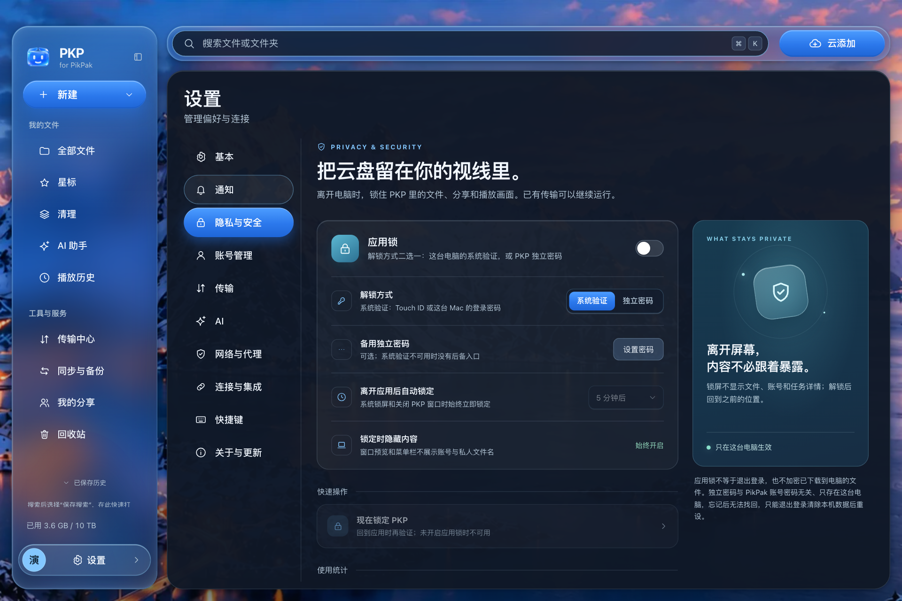

# PKP

**Your cloud files, transfers, and playback. One desktop workspace.**

[简体中文](README.md) · English

[User guide](docs/USAGE.md) · [Releases](https://github.com/tonyflux/pkp/releases) · [Report an issue](https://github.com/tonyflux/pkp/issues)

PKP is a **closed-source, unofficial desktop client for PikPak**, built for managing your own cloud files, transfers across multiple accounts, and media playback. PKP is not affiliated with or endorsed by PikPak. Use remains subject to PikPak's terms of service and applicable laws.

> **v0.1.0 is available** · [Download the latest release](https://github.com/tonyflux/pkp/releases/latest) for macOS Universal or Windows x64 / ARM64. Read the [installation guide](docs/INSTALL.md) and verify the assets before installing. This repository contains public documentation, feedback, and releases—not PKP application source code or build tools.

## A workspace for everyday file management

Browse your cloud drive, switch accounts, manage uploads and downloads, then preview or play a file without moving between separate tools.

*About the screenshots: the six interface images come from the actual application running locally in an isolated environment, using synthetic sample account and file data. The interface is in Simplified Chinese. They contain no real user accounts or content and are not evidence of verified production cloud operations. The player image includes a composited frame, as explained below; the assistant and sync images show the home screen and scan preview, not model inference or sync execution results.*

## Find your files faster

Search your own cloud files through a local index, with sorting, type filters, and favorites to keep everyday content within reach. The initial index takes time to build; search and drive-wide statistics may need to wait until it is ready. Local indexed search does not require sending file names to an AI model.

## Playback, right in your workspace

The integrated player supports quality switching, subtitle and audio-track selection, playback resume, and a separate player window. Availability depends on the file, codec, and service. **AI subtitle generation is not provided.**

*Image provenance: actual player controls and backend state from the isolated environment. Because the browser cannot capture the native video surface, a real decoded frame from a locally generated demo video is composited beneath the controls. This is not verification of native video rendering.*

## A helping hand for file organization

Start with local rules, indexed search, and statistics, or optionally connect your own model service. Sending file names, paths, or other metadata or authorized content to a model requires data-level consent. Levels set to “Always allow” do not prompt every time and can be managed in settings. Before writes such as renaming or moving files, review and confirm the actual operation plan. **AI accuracy is not guaranteed:** consent does not make a result reliable, and service charges depend on your chosen provider.

*Image provenance: a local, isolated capture of the actual AI assistant home screen. No online model inference was performed; the image does not show or imply model response quality.*

## Folder sync: preview before you run

Choose two-way sync, local-to-cloud backup, or cloud-to-local download. Scan both folders, review the operation preview produced by the actual scan, then execute the changes. Conflicts can keep both copies, and deletion protections and confirmations help guard against unwanted removal; neither replaces checking the preview or backing up important files.

*Image provenance: the actual sync interface showing a preview produced by scanning local synthetic test data, with the temporary local directory path anonymized. No sync was executed; this is not a production cloud-transfer result.*

Sync only works while the PKP process is running. It is not a real-time service, a system-level background daemon, or a complete backup solution. Content verification may read cloud files and consume download traffic.

## What you can do

| Your task | What PKP provides |
| --- | --- |
| Manage multiple accounts | Sign in and switch accounts, with independent background uploads and downloads. Accounts are not merged into a single drive. |
| Browse and share | Folder browsing, local indexed search, sorting, filters, favorites, sharing, and image, text, and PDF previews. |
| Manage transfers | Add links or torrents for cloud download, upload local files and folders, download to your computer, and manage transfer progress. |
| Play media | An integrated player with quality switching, subtitles, playback history, and a separate player window. Availability depends on the file and service. |
| Sync and organize | Two-way folder synchronization, local-to-cloud backup, and cloud-to-local downloads, with previews and conflict handling before execution; cleanup, rule-based renaming, and media organization. Optional connections to your own AI model service and TMDB credentials. |
| Make it yours | Simplified Chinese, Traditional Chinese, English, Japanese, and Korean interfaces, plus themes and wallpaper settings. |

Cloud capabilities, network access, and quotas depend on PikPak's service and your account. PKP does not provide content resources or bypass server-side permissions or Premium restrictions. Synchronization only runs while the PKP process is running; it is not a real-time service or a system-level background daemon. Back up important files and review operation previews before synchronization, cleanup, or bulk organization.

## Understand privacy before signing in

Privacy-related options are available in settings. The following behavior is also important to understand before using PKP.

- **Usage statistics are on by default and can be disabled.** Production builds send usage statistics by default; turn them off under Settings → Privacy & Security without affecting normal use. Payloads do not contain accounts, file names, paths, search terms, question text, or file contents. A random installation identifier can link statistics from the same installation across days. Turning statistics off does not automatically delete data already received by the server.
- **Update checks have a separate switch.** Production builds enable update checks by default; disable them separately under About & Updates. Disabling usage statistics does not disable update checks. Packages are not downloaded or installed automatically.
- **Sign-in includes a referral submission.** After each successful form-based sign-in, including adding an account or signing in again, PKP submits a preset developer referral code to PikPak in the background to attempt to establish a referral relationship. **There is no separate opt-out switch.** Failure does not affect sign-in; restoring a session or refreshing a token does not trigger submission. The registration link also includes promotional parameters that may create referral attribution.
- **AI and TMDB connections are optional.** Use your own services and credentials, and review data authorization prompts before sending information. AI requests may include file names, paths, and other authorized context. The application lock does not encrypt local data.

See the [privacy notice](PRIVACY.md) for the full data scope, storage details, and deletion limitations.

## Platform and installation limits

**Official installation packages are available in [Releases](https://github.com/tonyflux/pkp/releases/latest).** The maintainer reported successful acceptance of the initial draft; this does not establish comprehensive validation across all platforms, devices, or features below.

| Platform | Current status |
| --- | --- |
| macOS | Universal application targeting macOS 12 or later, for Apple silicon and Intel. Current packages use ad hoc signing and are not notarized by Apple. |
| Windows | A combined x64 / ARM64 installer is available. Broader real-device coverage is still needed for playback, synchronization, notifications, and system authentication. Some macOS integrations are unavailable. No Authenticode publisher signature. |
| Linux | Support and distribution packages are not currently promised. |

See the [installation guide](docs/INSTALL.md) for requirements and first-launch precautions. Download packages only from this repository's official [Releases](https://github.com/tonyflux/pkp/releases/latest) and follow the corresponding verification instructions.

## Our commitment to a full open-source release

**PKP is currently being developed as closed-source software, but it will be fully open-sourced—not just selected modules or a stripped-down edition.**

For now, we want to improve the core experience through real usage feedback. Before opening the source, we will complete sensitive-information cleanup, review third-party licenses, and organize build instructions and developer documentation, so the result is a project people can build, understand, and maintain—not just a code dump.

**Once the project reaches its usage target and these preparations are complete, we will publish the complete PKP-owned application source code, build scripts, and developer documentation under an open-source license.** The usage target, metric, measurement method, and release arrangements will be announced in this repository. We are not promising a specific date yet. This plan does not require users to enable usage statistics; disabling statistics does not affect normal use.

The current [LICENSE](LICENSE) continues to apply to existing versions. This plan does not grant advance access to the source code or open-source usage rights. Third-party components remain subject to their respective licenses.

## Guides and feedback

The detailed guides and reference documents below are currently in Simplified Chinese.

| Resource | What it covers |
| --- | --- |
| [Installation and first launch](docs/INSTALL.md) | Download status, platform requirements, first launch, and updates. |
| [User guide](docs/USAGE.md) | Accounts, transfers, playback, synchronization, and data-operation precautions. |
| [Privacy notice](PRIVACY.md) | Local data, external services, usage statistics, referrals, and deletion limitations. |
| [Changelog](CHANGELOG.md) · [Releases](https://github.com/tonyflux/pkp/releases) | Documentation and development status; published release attachments and notes will be authoritative once available. |
| [Third-party components](THIRD_PARTY.md) · [Software use terms](LICENSE) | Third-party distribution obligations, copyright, and software use terms. |

Report problems or suggest improvements through [Issues](https://github.com/tonyflux/pkp/issues). **Do not post passwords, tokens, API keys, share passcodes, complete account details, or unredacted logs and screenshots. Do not upload the entire configuration directory.**
