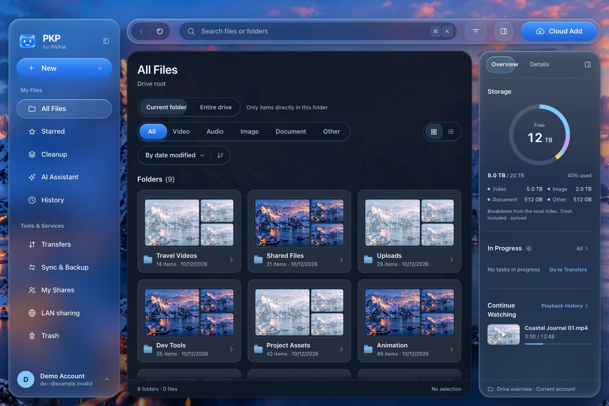
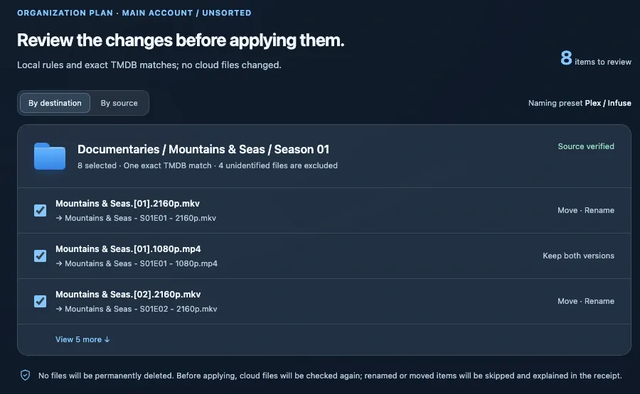
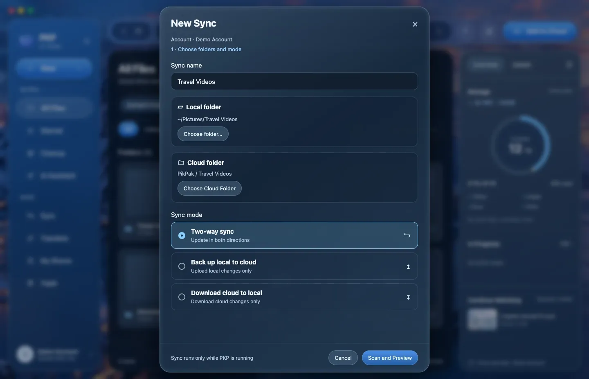
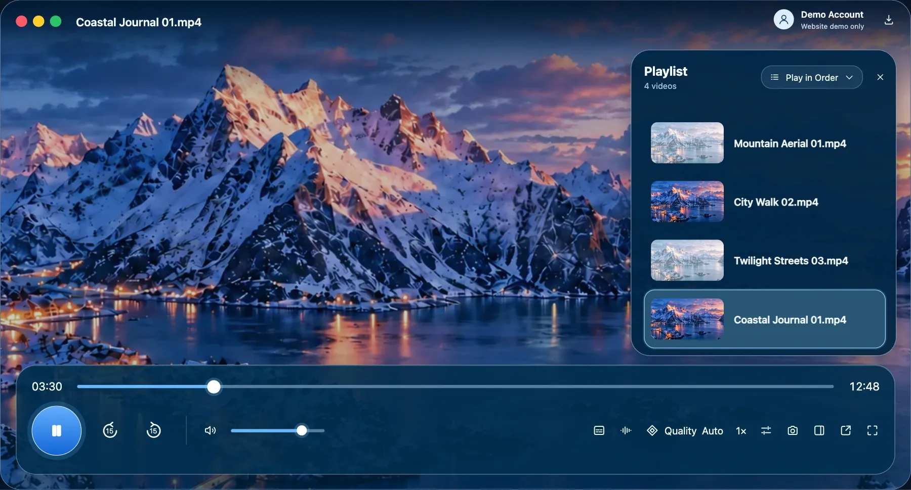
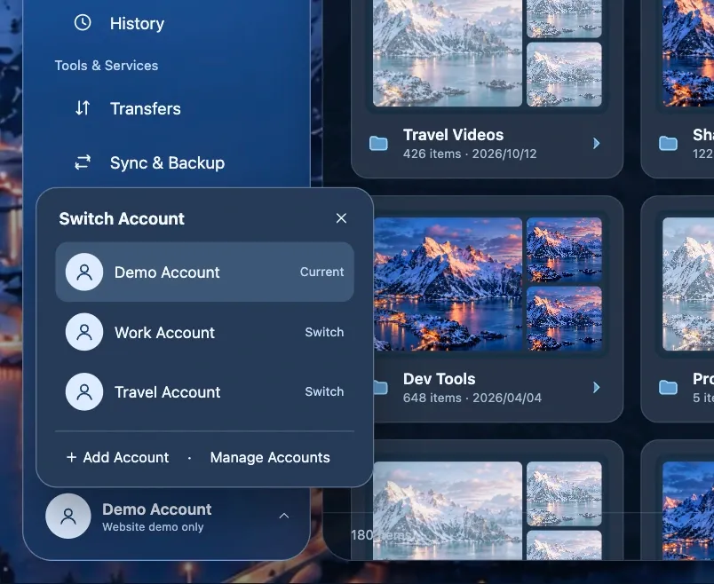
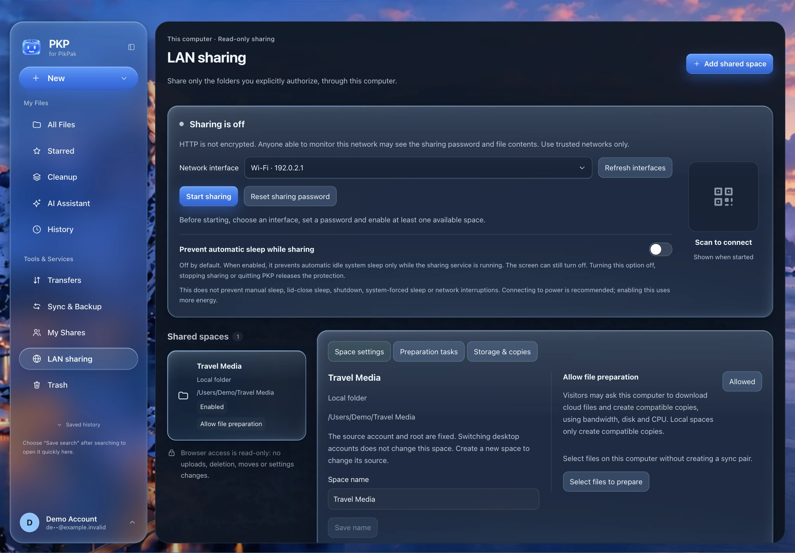
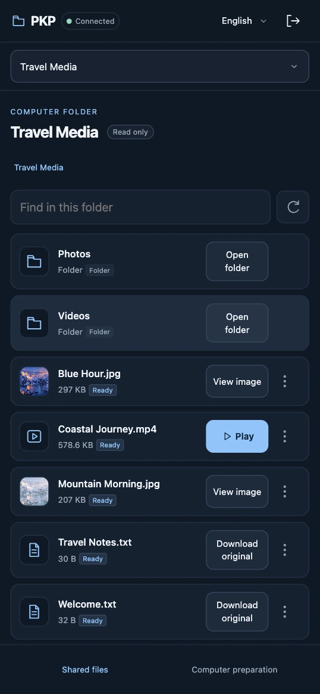
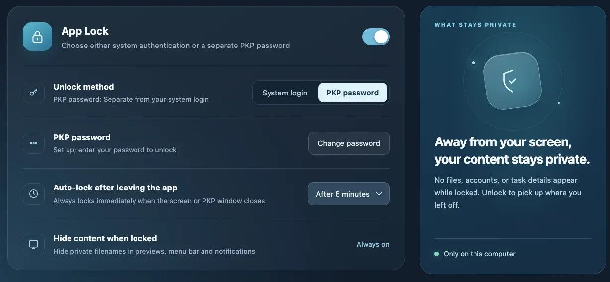

<div align="center">


# PKP

**Independent open-source desktop client for your PikPak files.**

Organize, sync, search, and play in one workspace. macOS 12 or later, and a Windows preview.

[简体中文](README.zh-CN.md) · English · [pkpapp.cc](https://pkpapp.cc/en)

[](LICENSE)
[](https://github.com/tonyflux/pkp/releases/latest)
[](https://github.com/tonyflux/pkp/releases/latest)
[](https://github.com/tonyflux/pkp/releases/latest)

[Install](#install) · [User guide](docs/USAGE.en.md) · [Releases](https://github.com/tonyflux/pkp/releases) · [Issues](https://github.com/tonyflux/pkp/issues)

</div>

PKP is an independent desktop client for a PikPak account you already have. It is unaffiliated with PikPak. Use remains subject to PikPak's terms and applicable law. The source in this repository is [GPL-3.0-only](LICENSE).

<p align="center">
  
</p>

<p align="center"><i>Current files workspace in an isolated browser preview, using fictional account, folders, storage figures and image previews. No production cloud data is shown.</i></p>

## What you can do

- **AI organizing assistant, with review before apply.** Local filename rules can draft a plan with no model. You can also connect your own model (or local Ollama) and TMDB credentials. Renames, moves, and cleanup wait until you confirm the plan.
- **Folder sync.** Pair a local folder with a cloud folder. Two-way sync, local-to-cloud backup, or cloud-to-local download. PKP scans both sides and shows the plan before it runs. Sync works while PKP is open.
- **Native playback.** A bundled libmpv player: quality switching, subtitles, audio tracks, resume, and a separate window. Availability depends on the file, codec, and service.
- **LAN sharing.** Share selected local or cloud folders read-only with a separate password. Devices on the same network can browse, download originals, and play supported media through a responsive browser page while PKP is running.
- **Share Import.** Paste a PikPak share link or explicitly open `pkp://share`; desktop builds also detect validated clipboard shares at startup or when returning to PKP. Browse a read-only grid/list preview, then explicitly choose the receiving account and destination folder and confirm. Detection and preview never import automatically. See the [user guide](docs/USAGE.en.md#import-a-pikpak-share).
- **Local index search.** Each account keeps an index on this computer, with type, size, and other filters. Search does not send file names to a model. The first index takes time.
- **Multiple accounts.** Each account has its own session, transfer queue, and index. Switching accounts leaves the others' transfers running.
- **Privacy on this computer.** Remembered passwords and optional API keys use the macOS Keychain or Windows Credential Manager. See [Privacy](#privacy).

The interface is available in English, Simplified Chinese, Traditional Chinese, Japanese, and Korean.

## Install

**[PKP 0.4.0](https://github.com/tonyflux/pkp/releases/tag/v0.4.0)** adds read-only LAN sharing, Share Import previews, external magnet/torrent opening, unified grid/list pickers, and desktop context menus and shortcuts. Download only from this repository's [latest Release](https://github.com/tonyflux/pkp/releases/latest), then check `SHA256SUMS` from the same release. Details and first-launch steps are in the [installation guide](docs/INSTALL.en.md). v0.2.0 was the first open-source release.

| Platform | Download |
| --- | --- |
| macOS 12 or later, Apple silicon and Intel | [PKP-0.4.0-macos-universal.dmg](https://github.com/tonyflux/pkp/releases/download/v0.4.0/PKP-0.4.0-macos-universal.dmg) |
| Windows x64 / ARM64 preview | [PKP-0.4.0-windows-x64-arm64-setup.exe](https://github.com/tonyflux/pkp/releases/download/v0.4.0/PKP-0.4.0-windows-x64-arm64-setup.exe) |

The macOS build is ad hoc signed and is not notarized, so the system may ask you to approve the first launch. The Windows build has no Authenticode publisher signature, and playback, sync, notifications, and system authentication still need broader testing on real devices. Linux packages are not available.

**Homebrew.** PKP has no cask. `brew install --cask pikpak` installs PikPak's own app, which is a different program.

Since v0.2.0, releases use eight assets: the two installers, `update.json`, `update.json.sig`, `PKP-<version>-source.tar.gz`, `libmpv-sources.tar.gz`, `LICENSE`, and `SHA256SUMS`. v0.4.0 retains this set and the same update trust key. The historical [v0.1.0](https://github.com/tonyflux/pkp/releases/tag/v0.1.0) installers stay under the proprietary terms shipped with that release. Prefer the latest public v0.4.0 for a new install. Usage statistics defaulted to off in v0.2.0 and on in v0.1.0, and daily active installation statistics default to on since v0.3.0.

## In the app

<table>
  <tr>
    <td width="50%" valign="top">
      
      <br><b>Review the plan</b> before a rename or move runs.
    </td>
    <td width="50%" valign="top">
      
      <br><b>Scan, then sync.</b> Confirm the preview first.
    </td>
  </tr>
  <tr>
    <td width="50%" valign="top">
      
      <br><b>Play with libmpv</b> inside the workspace.
    </td>
    <td width="50%" valign="top">
      
      <br><b>Switch accounts</b> without merging drives.
    </td>
  </tr>
</table>

The four images above are illustrations from [pkpapp.cc/en](https://pkpapp.cc/en), redrawn from the UI with fictional demo data. An English capture of local search is not in the repository yet.

## LAN sharing

Choose a local folder or a fixed account and cloud folder, then set a separate password and start sharing. The visitor page is read-only. It can request file preparation if allowed; playback depends on the media and device. Sharing is off by default and stops when PKP exits.

<p align="center">
  
</p>

<p align="center"><b>Desktop:</b> choose the sharing scope and permissions.</p>

<p align="center">
  
</p>

<p align="center"><b>Visitor:</b> browse the authorized files.</p>

These captures use the current UI and a local, isolated example folder. The desktop capture uses a simulated demo account, path and network address; its sharing service is stopped. The mobile capture shows a real loopback visitor session with example files, not a real phone or production cloud content.

LAN access uses unencrypted HTTP: use it only on a trusted network and do not expose it to the public internet. See the [LAN sharing guide](docs/USAGE.en.md#lan-sharing) for setup, preparation, playback and security limits.

File browsing also includes right-click menus and shortcuts such as F2 rename and copy/cut/paste. Magnet links and torrent files can open PKP's cloud-add confirmation without submitting a task automatically. See the [user guide](docs/USAGE.en.md).

## Build from source

Builds are documented for macOS 12 or later and produce a universal app. You need Go 1.26, Node.js 24, Xcode Command Line Tools, CMake, Python 3.10 or later, and the pinned Wails CLI. Full prerequisites, tests, and Windows cross-compilation are in the [development guide](docs/DEVELOPMENT.en.md).

```sh
xcode-select --install
go install github.com/wailsapp/wails/v3/cmd/wails3@v3.0.0-beta.28
export PATH="$(go env GOPATH)/bin:$PATH"
cd frontend && npm ci && cd ..
make app-go
```

`make app-go` writes `bin/pkp` and `bin/pkp.app`. From the same Mac, `make windows-installer` builds the Windows preview installer and needs NSIS.

## Privacy

Read the privacy notice before you sign in: [English](PRIVACY.en.md) · [简体中文](PRIVACY.md).

<p align="center">
  
</p>

- Remembered passwords, AI API keys, and TMDB credentials go into the macOS Keychain (service `com.pkp.desktop`) or Windows Credential Manager. Session tokens still live in a local credentials file. “Remember account and password” and “Automatic login” start checked; clear them on the sign-in form if you want the password kept only in memory. App Lock limits access inside the app. It does not encrypt downloaded files or the whole configuration directory.
- Daily active installation statistics default to on in v0.3.0, including existing settings with no explicit choice, while preserving identifiable explicit off choices. v0.2.0 defaulted to off; v0.1.0 defaulted to on. A one-time notice explains the default and where to turn statistics off in Settings → Privacy & Security, also accessible before sign-in. Acknowledging or dismissing it is not consent and leaves statistics enabled; the notice has no turn-off button. With a reporting endpoint, recording starts at startup and sending can begin about 30 seconds later, before acknowledgment; without an endpoint, neither collection nor the notice occurs. Reports contain a random installation ID, version, OS/architecture, language and active local dates, not feature actions, frequencies, logs, accounts, filenames, paths, searches, questions or contents. This measures successfully reported active installations, not verified people or exact installs. Opt-out deletes the local ID and pending data, not server history. The app release does not deploy companion telemetry services.
- Each successful sign-in from the login form, including adding an account or signing in again, submits a preset developer referral code to PikPak. There is no separate switch. A failed submission still leaves you signed in. Restoring a session or refreshing a token does not submit it. The registration link also carries referral parameters.
- Update checks have their own switch. Production builds check GitHub for a new release and wait for you to download and install. Disabling statistics leaves update checks as they are.
- AI and TMDB are optional and use services and credentials you provide. After you allow a request, or choose “Always allow” for that account, the model can receive the question, conversation, and task metadata such as file names and paths. Review the prompt in the app before you send anything.

Local data, deletion limits, and the statistics endpoint are spelled out in [PRIVACY.en.md](PRIVACY.en.md).

## Platforms

| Platform | Status |
| --- | --- |
| macOS | Universal app for macOS 12 or later. Ad hoc signature, not notarized. |
| Windows | One x64 / ARM64 preview installer. No Authenticode publisher signature. Some macOS-only integrations are absent, and real-device coverage is still thin. |
| Linux | No packages and no support commitment. |

PKP works with files in your own PikPak account. Quotas, network access, and Premium-only features follow that account. Back up important files before sync, cleanup, or a bulk organize.

## Source and license

Copyright (C) 2026 tonyflux. PKP-owned source, build scripts, and documentation in this repository are [GPL-3.0-only](LICENSE). Third-party components keep their own licenses. See [THIRD_PARTY.en.md](THIRD_PARTY.en.md).

v0.2.0 is the first open-source release. Its `PKP-0.2.0-source.tar.gz` is the PKP-owned source that corresponds to that release's installers, and `libmpv-sources.tar.gz` is the separate third-party source archive. v0.1.0's seven assets and [proprietary terms](docs/legal/v0.1.0-proprietary.txt) are unchanged. Those installers were built from a different source than this tree.

The notes that used to lead this README are kept in [docs/legal/version-licensing.en.md](docs/legal/version-licensing.en.md). The wording is unchanged except the installation-guide link, which now points at that file’s location. The record’s opening section is the publication status above. It supersedes the older “v0.2.0 has not been published” sentence inside the retained notes.

The sign-in code uses identity parameters and signing constants associated with PikPak's official Android client, so this public source discloses those values. The maintainer has confirmed that the current parameters may be published and reused. That confirmation is not an endorsement by PikPak. Referral behavior is described in the [privacy notice](PRIVACY.en.md).

## Guides

| | |
| --- | --- |
| [Installation and first launch](docs/INSTALL.en.md) | Downloads, checks, first launch, updates. |
| [User guide](docs/USAGE.en.md) | Accounts, transfers, playback, sync, bulk actions. |
| [Privacy notice](PRIVACY.en.md) | Local data, statistics, referrals, deletion limits. |
| [Changelog](CHANGELOG.en.md) | Documentation and development record. Release assets and notes on GitHub are authoritative for each release. |
| [Development](docs/DEVELOPMENT.en.md) | Local build, tests, release packaging. |
| [Contributing](CONTRIBUTING.en.md) · [Security](SECURITY.en.md) | How to propose a change, and how to report a vulnerability. |

When you [open an issue](https://github.com/tonyflux/pkp/issues), remove passwords, tokens, API keys, share codes, and full account details from logs and screenshots. Do not upload the configuration directory.
