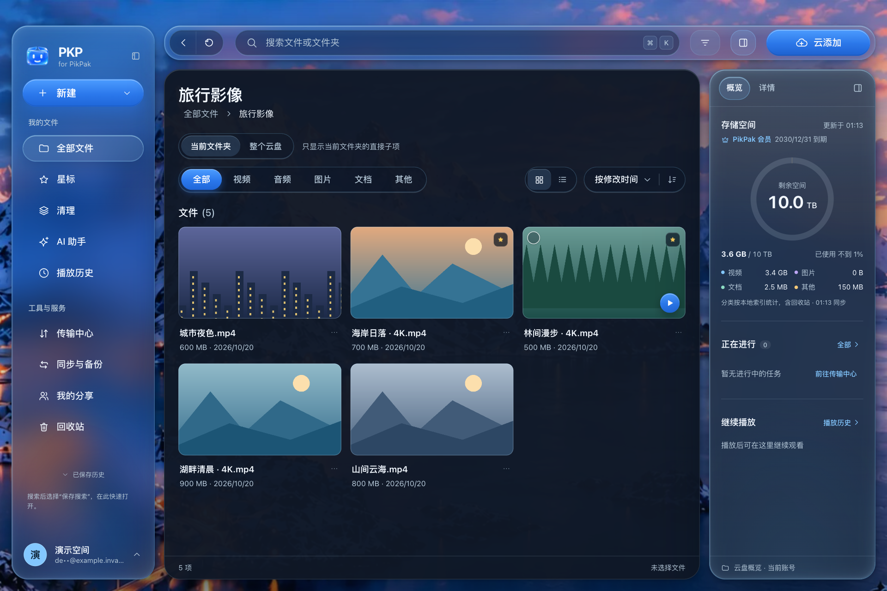
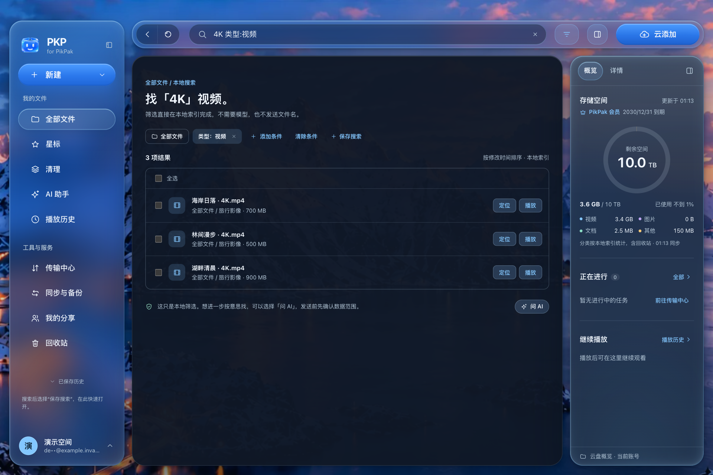
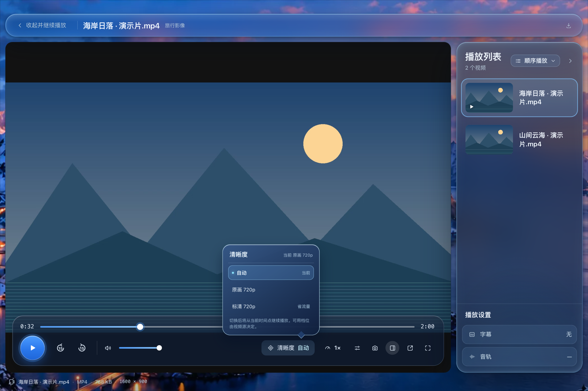
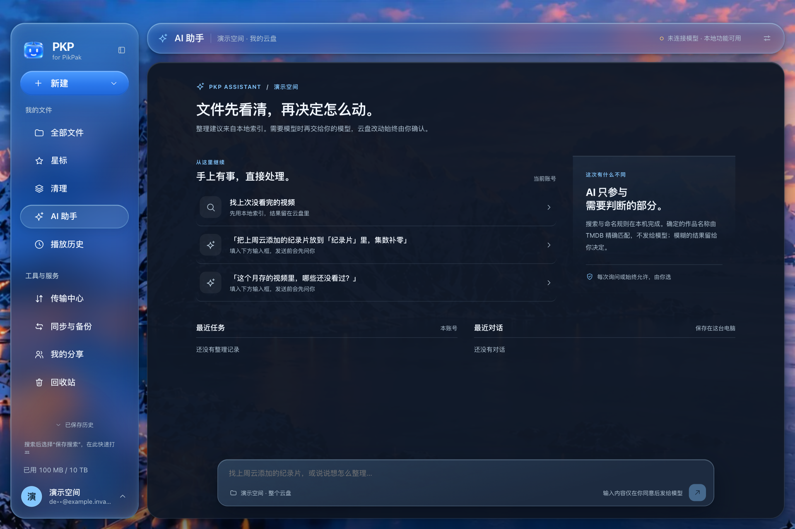
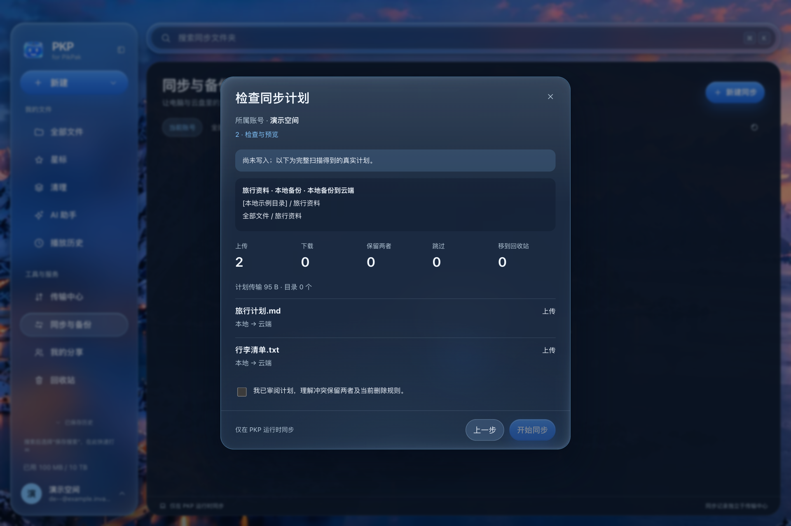
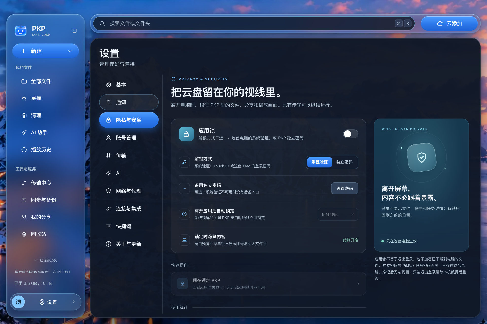

# PKP

**把云盘文件、传输与播放，放进一个桌面工作区。**

简体中文 · [English](README.md)

[使用指南](docs/USAGE.md) · [发布动态](https://github.com/tonyflux/pkp/releases) · [问题反馈](https://github.com/tonyflux/pkp/issues)

PKP 是面向 PikPak 用户的**非官方桌面客户端**，用于管理自己的云盘文件、多账号传输与媒体播放。PKP 不隶属于 PikPak，也不代表其运营方；使用时仍须遵守 PikPak 的服务条款与适用法律。

> **v0.3.0** 新增扫码登录、Google Gemini API Key 支持并修复登录体验，提供 macOS Universal 与 Windows x64 / ARM64 安装包。从 [最新 Release](https://github.com/tonyflux/pkp/releases/latest) 下载；安装前请阅读[安装说明](docs/INSTALL.md)并校验同一 Release 的 `SHA256SUMS`。
>
> v0.1.0 安装包仍适用当时的闭源条款，且不是由本仓库这份源码构建。原先放在文首的许可说明已原样移至 [版本许可记录](docs/legal/version-licensing.md)。v0.2.0 的八件附件与 v0.1.0 的七件附件及原有条款，以该记录为准。

## 一个工作区，照顾日常文件操作

浏览云盘、切换账号、管理上传下载，再打开文件预览或播放，减少在不同工具之间来回切换。

*截图说明：本文六张界面图片来自实际应用在本地隔离环境中的运行，使用合成示例账号与文件数据，界面语言为简体中文，不包含真实用户账号或内容，也不代表已通过生产云端操作验证。播放器画面另有下述合成说明；AI 助手与同步图片分别展示首页和扫描预览，不代表模型推理或同步执行结果。*

## 更快找到文件

通过本地索引搜索自己的云盘文件，结合排序、类型筛选与星标整理日常内容。首次建立索引需要时间，搜索与全盘统计可能要等待索引就绪；本地索引搜索不需要把文件名发给 AI 模型。

## 播放，就在工作区

内置播放器支持清晰度切换、字幕与音轨选择，记住播放进度，也能移到独立窗口继续观看。具体可用性取决于文件、编码与服务；**不提供 AI 字幕生成**。

*图片说明：实际播放器控件与后端状态来自隔离环境；浏览器无法捕获原生视频表面，因此在控件下合成本地生成演示视频的真实解码帧。此图不是原生视频渲染效果的验证。*

## 整理文件，多一个助手

先用本地规则、索引搜索与统计，也可按需接入自己的模型服务。向模型发送文件名、路径等元数据或已授权内容前，需按数据级别授权；已设「始终允许」的级别不会每次询问，可在设置中管理。涉及改名、移动等写操作时，先审阅并确认实际操作计划。**AI 不保证判断准确**，授权不等于结果可靠，服务费用由所选服务决定。

*图片说明：实际 AI 助手首页的本地隔离截图，未进行在线模型推理，不展示或暗示模型回答效果。*

## 文件夹同步，先看再执行

按需要选择双向同步、本地备份到云端或云端下载到本地；先扫描两端目录，审阅真实扫描生成的操作预览，再执行变更。冲突可选择保留双方副本，删除操作有保护与确认机制，但不能代替检查预览或备份重要文件。

*图片说明：实际同步界面使用本地合成测试数据完成扫描后生成的预览，本地临时目录路径已脱敏。未执行同步，不代表生产云端传输结果。*

同步仅在 PKP 进程运行时工作，不是实时服务或系统级后台守护，也不是完整备份方案；内容核对可能读取云端文件并消耗下载流量。

## 日常能力一览

| 你想做什么 | PKP 提供什么 |
| --- | --- |
| 管理多个账号 | 多账号登录与切换，各账号后台上传、下载相互独立；不会合并成一个云盘。 |
| 浏览与分享 | 文件夹浏览、本地索引搜索、排序筛选、星标、分享，以及图片、文本、PDF、DOCX 和 XLSX 等预览；PPT/PPTX 无内置预览，仍可下载等。 |
| 管理传输 | 云添加、本地文件与文件夹上传、下载到电脑，以及传输进度管理。 |
| 播放媒体 | 内置播放器，支持清晰度切换、字幕、播放记录和独立播放窗口，具体可用性取决于文件与服务。 |
| 同步与整理 | 文件夹双向同步、备份到云端或下载到本地，执行前预览与冲突处理；文件清理、规则改名和影视整理。可选接入自己的 AI 模型服务与 TMDB 凭据。 |
| 调整使用体验 | 简体中文、繁体中文、英语、日语、韩语界面，以及主题与壁纸设置。 |

云盘能力、网络访问和配额受 PikPak 服务及账号状态限制。PKP 不提供内容资源，不绕过服务端权限或会员限制。同步仅在 PKP 进程运行时工作，不是实时服务或系统级后台守护；同步、清理与批量整理前请备份重要文件并检查操作预览。

## 先了解隐私，再决定如何使用

隐私相关选项可在应用设置中查看；以下行为同样值得在登录前了解。

- **v0.3.0 的每日活跃安装统计默认开启，可在设置中关闭。** v0.1.0 默认开启，v0.2.0 默认关闭。已有配置未明确选择时随新默认开启；可识别的明确关闭保持关闭。一次性提示说明默认状态及「设置 → 隐私与安全」中的关闭入口，登录前也可访问；提示框不提供关闭统计按钮，确认或关闭只是已阅，不是同意，也不会关闭统计。有收集地址时启动即记录，约 30 秒后可发送，不等待提示已阅；无地址时不记录、不发送、不提示。只发送随机安装编号、版本、系统及架构、语言和活跃本地日期，不再发送功能行为、次数或运行日志，也不包含账号、文件名、路径、搜索词、提问正文或文件内容。这是成功上报的活跃安装统计，不是真实人数或精确安装量；离线与编号变化会影响覆盖。关闭删除本机编号与待发送数据，不会删除服务端已收到的数据，未认证报告仍可伪造。应用发布不等于配套统计服务已部署。
- **更新检查是独立开关。** 生产构建默认开启更新检查，可在「关于与更新」单独关闭；关闭使用统计不会关闭更新检查，不会自动下载或静默安装。当前源码的 macOS 更新需依次选择「下载更新 → 重启并更新」，保留账号与设置且不绕过 Gatekeeper；已发布的 v0.1.0 仍需手动覆盖一次才能获得此功能，详见[安装与更新说明](docs/INSTALL.md)。
- **登录包含邀请关系提交。** 当前每次通过登录表单成功登录后（包括添加账号与重新登录），会在后台向 PikPak 提交开发者预设的邀请码，尝试建立邀请关系，**没有单独的选择开关**。失败不影响登录；恢复会话或刷新令牌不触发提交。注册入口也包含推广参数，可能形成推广归因。
- **AI 与 TMDB 为可选连接。** 使用自己的服务和凭据，发送前阅读数据授权提示；AI 请求可能包含文件名、路径和其他已授权上下文。应用锁不等于本地数据加密。

完整的数据范围、存储与删除边界见 [隐私说明](PRIVACY.md)。

## 平台与安装边界

**正式安装包已在 [Releases](https://github.com/tonyflux/pkp/releases/latest) 提供。** 用户已反馈首发草稿验收通过；这不等于下列全部平台、设备和功能均完成充分验证。

| 平台 | 当前情况 |
| --- | --- |
| macOS | 面向 macOS 12 及以上的 Universal 应用，兼容 Apple 芯片与 Intel；当前打包方式为 ad hoc 签名，未经 Apple 公证。 |
| Windows | 提供 x64 / ARM64 共用安装包；仍需扩大真机覆盖，播放、同步、通知和系统身份验证等不能视为已在全部设备充分验证。部分 macOS 集成不可用；没有 Authenticode 发布者签名。 |
| Linux | 暂不承诺支持或提供发行包。 |

安装要求与首次启动注意事项见 [安装说明](docs/INSTALL.md)。请仅从本仓库的正式 [Release](https://github.com/tonyflux/pkp/releases/latest) 获取安装包，并按对应说明校验。

## 源码与许可证

Copyright (C) 2026 tonyflux。本仓库中的 PKP 自有源码、构建脚本和文档以 [GPL-3.0-only](LICENSE) 授权。第三方组件仍适用各自许可证。已发布的 v0.1.0 安装包继续适用随该版本分发的[闭源条款](docs/legal/v0.1.0-proprietary.txt)，不能把当前源码当作该安装包的对应源码。

本地构建见 [docs/DEVELOPMENT.md](docs/DEVELOPMENT.md)。当前登录实现使用与 PikPak 官方 Android 客户端相关的身份参数与签名常量；公开这份源码会公开这些值。维护者已确认当前身份参数可公开复用，参数与邀请行为保持不变；公开比对不代表 PikPak 官方背书，也不表示已独立取得 PikPak 的书面授权。邀请码行为已在[隐私说明](PRIVACY.md)披露。

## 指南与反馈

| 入口 | 内容 |
| --- | --- |
| [安装与首次启动](docs/INSTALL.md) | 下载状态、平台要求、首次启动与更新方式。 |
| [使用说明](docs/USAGE.md) | 账号、传输、播放、同步与数据操作提醒。 |
| [隐私说明](PRIVACY.md) | 本地数据、外部服务、使用统计、邀请关系与删除边界。 |
| [更新记录](CHANGELOG.md) · [Releases](https://github.com/tonyflux/pkp/releases) | 文档与开发状态；正式发布后以实际 Release 的附件及说明为准。 |
| [第三方组件](THIRD_PARTY.md) · [使用条款](LICENSE) | 第三方分发义务、版权与软件使用条款。 |
| [参与贡献](CONTRIBUTING.md) · [安全政策](SECURITY.md) | 贡献方式与安全问题报告方式。 |

欢迎通过 [Issues](https://github.com/tonyflux/pkp/issues) 报告问题或提出建议。**不要公开密码、令牌、API Key、分享口令、完整账号信息或未经脱敏的日志与截图，也不要上传整个配置目录。**
